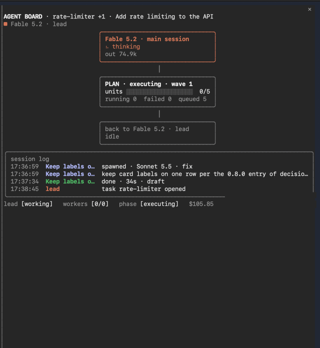

<p align="center"></p>

# Flowestra

**Run Claude Code as an orchestrator with a team of Opus, Sonnet and Haiku workers, and watch the whole thing live.**

Flowestra is a Claude Code mod. It gives the main session a routing policy for choosing which model does each piece of work, a gate that enforces that policy, a live board showing every worker, tasks that span several repositories at once, and a journal on disk of everything that was delegated.



*A staged demo run: the workers here only pause for a few seconds, so the recording shows the board and not real work.*

## What it is good for

- **Spending the expensive model where it matters.** Planning, design and anything risky goes to Opus. Specified work with a test to check it goes to Sonnet. Mechanical lookups and commands go to Haiku. The routing rules are written down, and every delegation records why it went where it did.
- **Keeping the main session's context for decisions.** Workers read the code and do the work in their own context. The orchestrator frames the problem, reviews what comes back and decides.
- **Working on several projects in one session.** Each piece of work is a task with its own repository, phase and units. Switching tasks takes one call, and the board hands back that task's state, so the session does not have to hold every project's history.
- **Being able to answer "what was done, and why".** Every delegation's brief, result and verdict is written to a journal, indexed by repository, task and phase.
- **Seeing what your agents are doing.** A pane beside the chat shows each worker's model, current tool, elapsed time and real token counts, with results flowing back to the lead.

## How it works

**Three tiers of workers.** The mod registers one worker type per tier, each pinned to its model and carrying its own return format:

| Worker | Model | Used for | Tools |
|---|---|---|---|
| `flowestra:haiku-worker` | Haiku | One mechanical task: locate, extract, run a command and report, inventory, a fully specified edit. Its results are leads, never conclusions | Read, Bash, Edit |
| `flowestra:sonnet-worker` | Sonnet | Specified work in one repository and one area, with written acceptance criteria and a named check. Its results are drafts the orchestrator verifies | Read, Bash, Edit, Write, WebFetch, WebSearch |
| `flowestra:opus-worker` | Opus | Design, unknown root causes, cross-repository changes, security, migrations, and anything the other two gates do not pass | Everything the orchestrator has, except spawning agents |

**A routing policy, in one place.** The mod adds a Model Routing Policy to the orchestrator's instructions: a procedure to run for every delegation (any Opus trigger? does the Haiku gate hold? does the Sonnet gate hold? otherwise Opus), what each tier's brief must state, what each tier returns, and how failures escalate upward. Its text lives in `hooks/policy.ts` and nowhere else.

**A gate that enforces it.** Before a worker starts, the board checks that a declared unit of work covers it, with a tier, a task type and an audit line of four parts: the task, the tier, the routing step that selected it, and what will catch an error. A worker with no such unit is refused. So are:

- the built-in agent types the tier workers replace (`Explore`, `Plan`, `general-purpose`, `claude`, `web-fetch`, `claude-code-guide`);
- forks, which would copy the whole conversation and run on the orchestrator's own model with no tier and no audit line;
- a worker for a unit that was rejected, a third run of one unit at the same tier, and a task type barred at a tier after two rejections in a session;
- a worker whose unit names a spec file or a context item that does not exist.

The gate fails open: if the board cannot read its own state, the worker starts.

**Context instead of forks.** A unit can name up to eight things its worker needs from earlier work: a file (optionally one `#heading` of it) or an earlier unit's journal entry. The mod places their text in the worker's brief, so the worker never needs the orchestrator's conversation. When a task works in another repository, the worker runs in that repository's folder and is given its `CLAUDE.md`.

**A work journal.** Every covered delegation is written to disk as it starts, finishes and receives its verdict:

```
~/.claude/flowestra/journal/
  index.md                           one line per repository
  <repo>/index.md                    one line per task
  <repo>/<task>/index.md             one line per phase, plus the task's state file
  <repo>/<task>/<phase>/index.md     one line per delegation
  <repo>/<task>/<phase>/<entry>.md   the audit line, the brief, the result, the verdict
```

The mod writes it mechanically from what it sees; no model writes summaries for it. Index lines are capped at 160 characters, so the indexes stay small however long the work runs, and several sessions can write to the same journal at once.

## Install

At the prompt of a Claude Code terminal session:

```
/plugin install flowestra --marketplace Osanchez/Flowestra
```

Answer `y` to add the marketplace, then choose a scope (the user scope makes it available in every project).

From a shell:

```
claude plugin install flowestra --marketplace Osanchez/Flowestra
```

In the desktop app: click **+** next to the prompt box, then **Plugins**, **Add marketplace** with `Osanchez/Flowestra`, then **Add plugin**.

The pane opens by itself when workers start. `/board` opens or closes it.

**Requirements.** A Claude Code build that supports mods (plugins with a hooks module). Flowestra was built and tested on Claude Code 2.1.325, with an account that can use Opus, Sonnet and Haiku models.

## Setting it up in your repository

Installing the mod gives the main session the routing policy, the workers, the gate, the board and the journal. The workflow around them (who designs, who approves, when a spec is written down) is a set of instructions you keep in your own `CLAUDE.md`.

1. **Add the workflow.** Copy [`docs/CLAUDE.example.md`](docs/CLAUDE.example.md) into `~/.claude/CLAUDE.md` to use it in every project, or into a project's `CLAUDE.md` for one project. It describes the orchestrator's role, the steps of a task (frame, design, review, approval, spec to disk, execution, test, review) and how the board is kept current. Edit it to suit how you work.
2. **Keep approved designs in `decisions.md`.** The workflow writes each approved design as a dated entry in `decisions.md` at the project root, and worker briefs point at that entry.
3. **Add project constraints, if any.** A project's `CLAUDE.md` can list resources its work shares (one test database, one device, one editor) and can send a kind of work to a higher tier than the policy would. It should never send work to a lower one: the policy is the only source of routing rules.
4. **Start working.** Ask for something that needs more than one step. The orchestrator opens a task, declares its units and spawns workers, and the board shows them.

What a declaration looks like, through the `AgentBoard` tool the mod registers:

```json
{
  "taskId": "rate-limit",
  "task": "Add rate limiting to the API",
  "phase": "executing",
  "wave": 1,
  "units": [
    {
      "id": "find",
      "label": "Locate call sites",
      "wave": 1,
      "tier": "haiku",
      "kind": "locate",
      "audit": "find every call site of the request handler | haiku | step 2: Haiku gate holds: exact symbol and scope pinned, checkable by re-running the search | I read the cited lines"
    },
    {
      "id": "build",
      "label": "Implement the limiter",
      "wave": 2,
      "dependsOn": ["find"],
      "tier": "sonnet",
      "kind": "implement",
      "audit": "implement the limiter from the approved spec | sonnet | step 3: Sonnet gate holds: one area, criteria in the spec, tests named as the check | the tests, then my review",
      "spec": "decisions.md",
      "context": ["rate-limit:find", "/path/to/repo/decisions.md#Rate limiter"]
    }
  ]
}
```

A worker is linked to its unit by the Agent call's `name` (the unit id) or, where the Agent tool takes no name, by a description equal to the unit's label.

## The `AgentBoard` tool

| Field | Meaning |
|---|---|
| `taskId` | The task this update is about. A new id opens a task, an open id switches to it, and a known id from an earlier session resumes it from its state file |
| `task` | The task's one-line title |
| `repo` | The repository or folder the task works in (default: the session's) |
| `phase` | analysis, design, approval, executing, testing, review or done |
| `wave` | The wave of workers running or about to start |
| `units` | The full list of the task's work units (it replaces the previous list) |
| `close` | `true` closes the active task |

Each unit has an `id`, a `label` of one to four words, a `wave` and optional `dependsOn`. A unit a worker carries out also has:

| Field | Meaning |
|---|---|
| `tier` | opus, sonnet or haiku: what the routing procedure selected |
| `kind` | The task type. Haiku: locate, extract, execute, inventory, edit. Sonnet: those and implement, tests, fix, explore, summarize, review, docs. Opus: all of those and design, debug |
| `audit` | `<task> \| <tier> \| <routing step and conditions> \| <what catches an error>` |
| `verdict` | accepted or rejected, sent once the orchestrator has checked the result. A rejection can later be corrected to accepted, which withdraws the failure |
| `spec` | The approved spec the unit builds from; its worker is refused while the file does not exist |
| `context` | Up to eight files or earlier units whose text is placed in the worker's brief (32,000 characters an item, 96,000 in all) |

A unit the orchestrator carries out itself has no tier and takes `declared` (pending, done or failed) instead.

## The Agent Board

The pane is a flow diagram, top to bottom: the lead's box, the plan box (phase, wave, units finished), a row of Haiku workers whose results are leads, a row of Sonnet and Opus workers, and the box where results return to the lead.

- **Colours by tier:** Haiku magenta, Sonnet blue, Opus lavender. A finished card turns green, a failed one red.
- **Live cards:** each shows its model and task type, a moving bar, its current tool, elapsed time and tokens in and out. Dots travel along the rails as work goes out and comes back. Token counts are real, never estimated.
- **Nothing slides past unchecked:** a finished Haiku or Sonnet card stays in its row, reading `lead · unchecked` or `draft · unchecked`, until its verdict is recorded.
- **Tasks:** the header shows the active task and how many others are open. Counts follow the active task; a worker of another task that is still running keeps its card, marked with that task's id.
- **Session log and detail:** below the diagram, a log of spawns, audit lines, verdicts and task changes. Click a card for its brief, routing and tools in flight.

On a narrow terminal a one-line row above the prompt stands in for the pane.

## Where files live

Flowestra keeps its files under Claude Code's config folder: the `CLAUDE_CONFIG_DIR` environment variable when it is set, otherwise `~/.claude`.

| Path | What |
|---|---|
| `<config>/flowestra/journal/` | The work journal |
| `<config>/flowestra/audit/<session id>.log` | One line per delegation that started in that session |

The board's answer to opening or switching a task states both paths.

## Things to know

- **Briefs and results are stored in full**, in plain text, on your machine. Nothing leaves it, but the journal holds whatever your briefs and results contain. There is no pruning yet.
- **The built-in agent types listed above are unavailable** to the main session while the mod is loaded. Skills that start their own agents may be refused by the gate.
- **Workflow agents, resumed agents and agents started by other agents** are not checked by the gate.
- **The mod is generic.** It contains nothing specific to any project.

## Development

```
claude plugin test <folder>       # runs every *.test.ts
claude plugin validate <folder>   # reads the manifest and type-checks the module
```

The module is `hooks/register.tsx`; everything else under `hooks/` is pure and tested on its own: `policy.ts` (the policy text), `workers.ts` (the three worker types), `board.ts` (the tool's parser), `state.ts` (the board's reducers and the gate), `journal.ts` (the journal's formats), `log.ts`, `view.tsx` and `flow.client.tsx` (the drawing), `guard.ts` (the fail-open helper).

## License

MIT. See [LICENSE](LICENSE).
