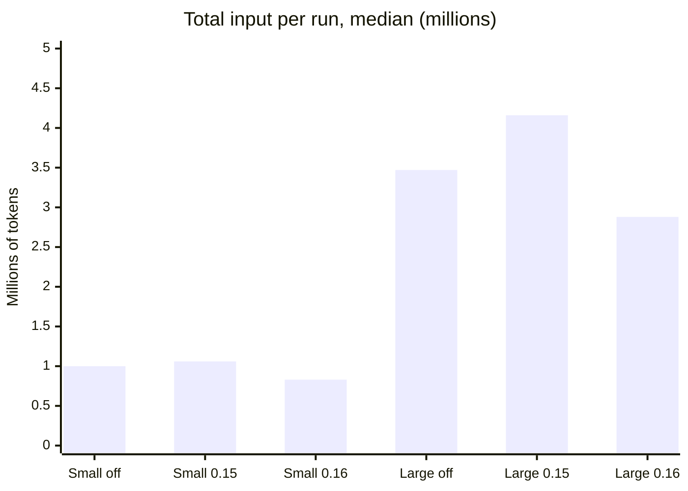
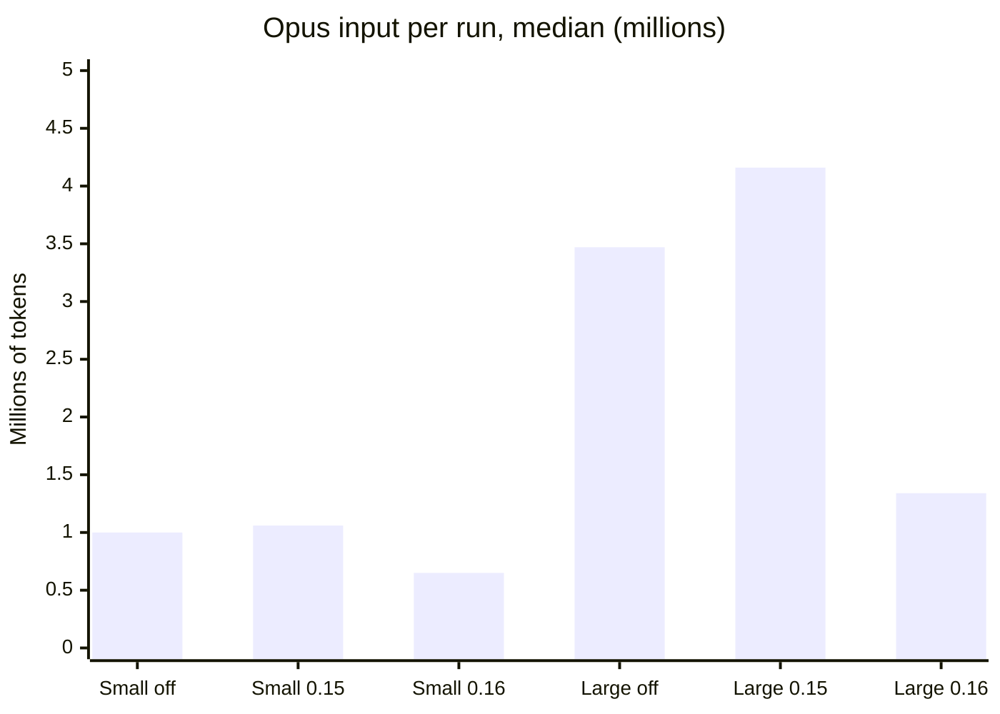
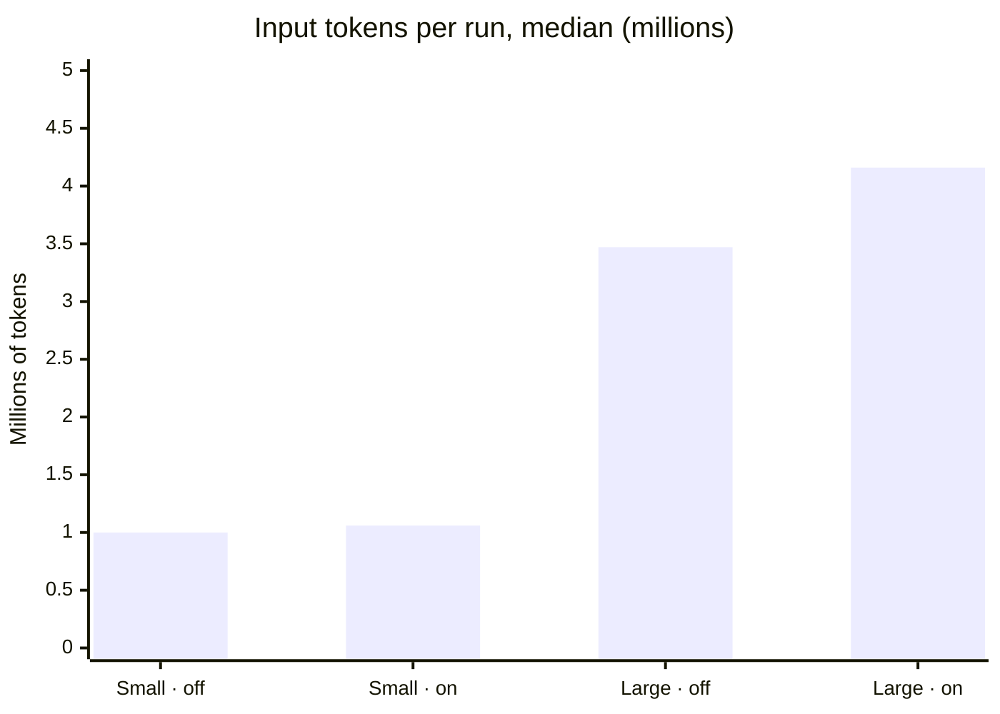

# Token benchmark: Claude Code with and without Flowestra

> **In short:** with Flowestra 0.16.0, where every change to project files goes to a worker, delegation now happens on its own: all 6 runs delegated and the lead made no file edits. Total input was **17% lower** than plain Claude Code on both the small and the large task. Opus tokens fell more: input **−35%** on the small task and **−61%** on the large one, because the work moved to Sonnet. The pass rate was the same (6/6). The sample is small (3 runs per cell). The fixed cost of about **8.7k tokens on every request** still applies. Total output and wall-clock time rose on the large task (+18% and +12%). The earlier 0.15.0 measurement, where the lead never delegated, and a forced-delegation test on 0.12.0 are kept below.

- **Measured:** 2026-11-16 · Flowestra 0.15.0 (commit `80f31ca`) and 0.16.0 (commit `6713e52`) · Claude Code 2.1.325 · lead model Opus 5.5
- **Runs:** 18 fresh headless sessions (12 in the 0.15.0 measurement, 6 more on 0.16.0). All 18 finished with the test suite passing.
- **Reproduce it:** everything used is in [`docs/benchmark/`](benchmark/).

---

## Results

### Flowestra 0.16.0: implementation is always delegated

0.16.0 changed the rule. The orchestrator plans and reviews, and every change to project files goes to a worker, usually one Sonnet unit (parallel units for bigger work). The orchestrator writes code itself only when the Sonnet switch is off. The same small and large tasks were re-run 3 times each with the mod on 0.16.0, with no forcing, from the same base commit `80f31ca`, with an Opus 5.5 lead, and compared with the existing mod-off and 0.15.0 runs.

"Input" counts every token the model read on every request: new input, cache writes and cache reads. That total doesn't change with cache warmth, so runs compare fairly whatever ran before them. "Output" is what the model wrote. Values are the median of 3, with the range in brackets.

| Task | Condition | Input | Output | Wall-clock | Tests |
|---|---|---:|---:|---:|---|
| Small (one journal fix) | Flowestra **off** | **1.00M** (0.83–1.11M) | **12.4k** (11.4–13.5k) | 2 m 52 s | 3/3 pass |
| Small (one journal fix) | Flowestra on, 0.15.0 | **1.06M** (0.96–1.36M) | **11.7k** | 2 m 25 s | 3/3 pass |
| Small (one journal fix) | Flowestra on, **0.16.0** | **0.83M** (0.70–0.93M) | **12.5k** (11.4–15.2k) | 2 m 25 s (123–174 s) | 3/3 pass |
| Large (three journal fixes) | Flowestra **off** | **3.47M** (2.47–4.02M) | **37.2k** (35.8–39.4k) | 8 m 03 s | 3/3 pass |
| Large (three journal fixes) | Flowestra on, 0.15.0 | **4.16M** (3.05–5.20M) | **37.0k** | 7 m 56 s | 3/3 pass |
| Large (three journal fixes) | Flowestra on, **0.16.0** | **2.88M** (2.62–2.98M) | **44.0k** (39.5–53.0k) | 8 m 59 s (508–604 s) | 3/3 pass |

In the 0.15.0 rows the lead never delegated. In the 0.16.0 rows all 6 runs delegated, and the lead made 0 file edits.

| 0.16.0 vs off (medians) | Small task | Large task |
|---|---:|---:|
| Total input | **−17%** | **−17%** |
| Opus input | **−35%** | **−61%** |
| Opus output | **−41%** | **−55%** |
| Total output | **+1%** | **+18%** |
| Wall-clock | **−16%** | **+12%** |

### The Opus and Sonnet split (0.16.0)

| Task | Opus input (lead, plus any Opus worker) | Sonnet input | Opus input, off | Lead requests (off) |
|---|---:|---:|---:|---:|
| Small | 0.65M (0.54–0.73M) | 0.15M (0.09–0.28M) | 1.00M (0.83–1.11M) | 11–15 (18–20) |
| Large | 1.34M (1.04–2.43M) | 1.58M (0.46–1.65M) | 3.47M (2.47–4.02M) | 15–20 (33–45) |

On the small task, all 3 runs delegated to one Sonnet worker and the lead made 0 file edits. On the large task, the lead alone read 1.12M (1.04–1.34M) of Opus input, and Opus output was 16.6k (14.5–37.4k) against 37.2k with the mod off. The Opus input range on the large task includes the run described below where one unit was escalated to an Opus worker.





Why it went down: the lead's context stays small. It makes fewer requests (11–20, against 18–45 with the mod off) because the edit, test and fix loop runs in the worker. Every lead request carries the full prompt of about 33k tokens plus a growing history, whereas the worker starts from a smaller prompt.

### Every 0.16.0 run

| Run | Total input | Total output | Lead (Opus) in, out | Workers | Time | Tests after |
|---|---:|---:|---|---|---:|---|
| small · 1 | 0.70M | 11.4k | 0.54M, 6.1k | Sonnet 0.15M, 5.3k | 123 s | 1032 pass, 0 fail |
| small · 2 | 0.83M | 12.5k | 0.73M, 7.3k | Sonnet 0.09M, 5.2k | 145 s | 1032 pass, 0 fail |
| small · 3 | 0.93M | 15.2k | 0.65M, 7.5k | Sonnet 0.28M, 7.7k | 174 s | 1037 pass, 0 fail |
| large · 1 | 2.62M | 44.0k | 1.04M, 16.6k | Sonnet 1.58M, 27.4k | 539 s | 1045 pass, 0 fail |
| large · 2 | 2.88M | 53.0k | 1.12M, 17.8k | Sonnet 0.46M, 15.6k, then Opus 1.31M, 19.7k | 604 s | 1044 pass, 0 fail |
| large · 3 | 2.98M | 39.5k | 1.34M, 14.5k | Sonnet 1.65M, 25.0k | 508 s | 1044 pass, 0 fail |

In large · 2 the Sonnet draft was incomplete. The lead escalated the unit to an Opus worker under the policy's escalation rule (§8) and then checked it itself.

---

### Before the 0.16.0 rule: Flowestra 0.15.0, where the lead never delegated

In the 0.15.0 measurement a "do it yourself" rule let the lead keep every task. These are the 12 runs (2 tasks × 2 conditions × 3 repeats) from that measurement, with the same definitions of input and output.

#### Total tokens per run (median of 3, range in brackets)

| Task | Condition | Input | Output | Wall-clock | Tests |
|---|---|---:|---:|---:|---|
| Small (one journal fix) | Flowestra **off** | **1.00M** (0.83–1.11M) | **12.4k** (11.4–13.5k) | 2 m 52 s | 3/3 pass |
| Small (one journal fix) | Flowestra **on** | **1.06M** (0.96–1.36M) | **11.7k** (11.3–12.4k) | 2 m 25 s | 3/3 pass |
| Large (three journal fixes) | Flowestra **off** | **3.47M** (2.47–4.02M) | **37.2k** (35.8–39.4k) | 8 m 03 s | 3/3 pass |
| Large (three journal fixes) | Flowestra **on** | **4.16M** (3.05–5.20M) | **37.0k** (31.5–49.4k) | 7 m 56 s | 3/3 pass |

| | Small task | Large task |
|---|---:|---:|
| Input, on vs off (medians) | **+6%** | **+20%** |
| Output, on vs off (medians) | −6% | −1% |
| Spread within one condition (input) | up to ±18% | up to ±29% |



#### Every run

| Run | Input | of which cache reads | Output | Requests to the model | Time | Tests after |
|---|---:|---:|---:|---:|---:|---|
| small · off · 1 | 0.83M | 0.78M | 11.4k | 18 | 148 s | 1034 pass, 0 fail |
| small · off · 2 | 1.11M | 1.05M | 13.5k | 20 | 187 s | 1036 pass, 0 fail |
| small · off · 3 | 1.00M | 0.94M | 12.4k | 20 | 172 s | 1036 pass, 0 fail |
| small · on · 1 | 1.06M | 1.00M | 11.3k | 21 | 131 s | 1033 pass, 0 fail |
| small · on · 2 | 0.96M | 0.90M | 11.7k | 17 | 145 s | 1036 pass, 0 fail |
| small · on · 3 | 1.36M | 1.30M | 12.4k | 24 | 163 s | 1036 pass, 0 fail |
| large · off · 1 | 4.02M | 3.90M | 35.8k | 45 | 483 s | 1045 pass, 0 fail |
| large · off · 2 | 2.47M | 2.37M | 37.2k | 33 | 449 s | 1046 pass, 0 fail |
| large · off · 3 | 3.47M | 3.35M | 39.4k | 41 | 503 s | 1049 pass, 0 fail |
| large · on · 1 | 3.05M | 2.94M | 31.5k | 34 | 476 s | 1044 pass, 0 fail |
| large · on · 2 | 4.16M | 4.04M | 37.0k | 45 | 469 s | 1043 pass, 0 fail |
| large · on · 3 | 5.20M | 5.06M | 49.4k | 49 | 659 s | 1055 pass, 0 fail |

The suite had 1029 tests before each run, so every run added tests. In every run the per-request token counts in the transcripts matched the engine's own usage ledger exactly.

#### Where the fixed cost comes from

| | Flowestra off | Flowestra on | Difference |
|---|---:|---:|---:|
| First request (system prompt, tools, task) | ≈ 24.0k tokens | ≈ 32.7k tokens | **+8.7k** |

That +8.7k is Flowestra's own text: the Model Routing Policy, the orchestrator workflow, the board instructions and the `AgentBoard` tool definition. It is sent with every request the lead makes, so a 20-request session reads about 170k more tokens and a 40-request one about 350k more, almost all as cache reads. That works out to roughly **+10–20% input** before any delegation, which matches the medians above. On top of it, the lead made 2–6 `AgentBoard` calls per run and, in 5 of 6 runs, wrote a `.flowestra/decisions.md` entry.

#### What the lead chose to do

In all 6 of these Flowestra runs the lead **did not delegate**. It opened a task on the board, declared its own units, wrote the approved design to `decisions.md` and did the work itself. That was the 0.14.0 delegation threshold working as designed: "do it yourself when the work fits in about ten tool calls, or touches one or two files in one area". So that measurement shows the cost of having the orchestrator available, not the cost of delegating. 0.16.0 replaced that rule, and its results are above.

### What forced delegation cost (an earlier test, 0.12.0)

An earlier experiment on Flowestra 0.12.0 forced delegation on a small task, before the threshold existed. It used a Fable 5.2 lead and **one run per condition**, so treat it as an anecdote:

| Condition (0.12.0, small task) | All tokens | Output | Wall-clock |
|---|---:|---:|---:|
| Flowestra off | 1.54M | 15.0k | 5 min |
| Flowestra on, did not delegate | 1.84M (+19%) | 17.5k | 9 min |
| Flowestra on, delegation forced | **4.88M (3.2×)** | **81.9k (5.5×)** | **24 min** |

In that run the lead's own tokens (1.48M) were about the same as the single session's (1.54M), so the workers came **on top**. The largest item was an Opus design draft at 1.78M, more than the whole session without the mod. That result is why 0.14.0 added the shorter worker returns and the rule that the lead drafts small designs itself. 0.16.0 avoids the two things that made delegation expensive there: the Opus design draft on a small task, and long worker returns.

---

## How to read this honestly

- **Three runs per cell is a small sample.** On the small task the 0.16.0 range (0.70–0.93M) overlaps the mod-off range (0.83–1.11M), so the −17% in total input is not separable from run-to-run spread there. The Opus-token ranges do not overlap: 0.54–0.73M against 0.83–1.11M on the small task, and 1.04–2.43M against 2.47–4.02M on the large one. Even so, three runs is not enough for precise percentages.
- **Output and time went up on the large task.** Total output rose 18% (44.0k against 37.2k) and wall-clock rose 12% (8 m 59 s against 8 m 03 s), because the work is written by a worker and then reviewed by the lead.
- **Tokens are not weighted by model.** The totals add Opus and Sonnet tokens as if they were equal. Sonnet is the smaller model, so the Opus figures are shown separately. One large run escalated a unit to an Opus worker, which is counted in the Opus input range.
- **Large is relative.** The "large" task took about 9 minutes. Work that is hours long, spans many areas or several repositories was not measured here.
- **One repository, one kind of work.** Both tasks were TypeScript changes with a test suite in Flowestra's own repository.
- **Headless runs skip the approval gate.** The prompt said the design was pre-approved, on both sides. In an interactive session the `full` workflow stops for your approval, which costs a turn of your time and few tokens.

---

## Benefits

| Benefit | What it gives you | What it costs |
|---|---|---|
| **Routing by rule** | Design and risky work goes to Opus, specified work with a test goes to Sonnet, read-only lookups go to Haiku, and every delegation records why it went where it did | Each worker starts cold and rereads what it needs |
| **A smaller lead context** | Workers run the edit, test and fix loop in their own context; the lead makes fewer requests (11–20 against 18–45 with the mod off) and keeps about 250-word returns, not file dumps. Measured with 0.16.0: Opus input −35% on the small task and −61% on the large one | Total output and wall-clock rose on the large task (+18% and +12%) |
| **Parallel waves** | Independent units run at the same time; dependent ones wait | More tokens in total; less wall-clock time only when the units are really independent |
| **An approval gate** (`full`) | Nothing is built until you approve a written design | One round trip with you |
| **A durable record** | `.flowestra/decisions.md` holds the approved designs; the journal holds every brief, result and verdict | Disk space, and care with what the journal stores (see the README) |
| **Visibility** | A live board shows each worker's model, tool and real token counts, and a Tokens tab splits the lead from the workers | About 8.7k tokens of instructions on every request (mostly cached) |
| **Enforcement** | A gate refuses unplanned or off-policy spawns and forks, and records the agents it can't check | Built-in agent types are unavailable while the mod is loaded |

## Limitations

- **Each worker starts cold.** A worker rereads the files it needs, and a unit that fails at one tier is rerun at another.
- **Escalations add an Opus worker.** In one of the three large runs the Sonnet draft was incomplete and the unit was rerun on Opus, which added 1.31M Opus input.
- **Output was larger on the large task.** Total output rose 18% and wall-clock 12% against the mod off.
- **Forced delegation with an Opus design draft was expensive.** In the 0.12.0 test it cost 3.2× the tokens of a plain session. 0.16.0 does not draft designs in an Opus worker on small tasks.
- **The fixed prompt cost applies to every request,** whether or not you use the board.
- **There is no live counterfactual.** The Tokens tab shows what was spent, not what the same work would have cost without the mod.

## When a tool like this is still worth it

Token efficiency isn't the only thing that matters. These are the situations where an orchestrator earns its overhead:

1. **Long, multi-part projects.** In a session that runs for hours, the lead's context is reread on every turn. The session that built Flowestra 0.9 to 0.11 reread 277M cached tokens in its lead alone. Moving the heavy reading into workers that end, and keeping only short returns, stops that context from growing without bound.
2. **Work across several repositories.** One task per repository, each with its own phase and units, and one call to switch between them. The lead doesn't need to keep every project's history in its context.
3. **Teams and regulated environments that need an audit trail.** "Which model changed this, from what brief, and who accepted it?" is answered from the journal and `decisions.md`, not from memory or scrollback.
4. **Work where a wrong change is costly.** Migrations, security, auth and data deletion go to Opus by rule, and the approval gate keeps anything from being built before a design is agreed.
5. **Bulk mechanical work.** Searches, inventories, extraction and fix-until-green loops can go to Haiku or Sonnet in parallel instead of taking many turns of the top model.
6. **Learning how agents actually spend tokens.** The board and the Tokens tab show where the tokens went, per model and per worker. That visibility is how the 0.14.0 savings were found.
7. **Keeping the top model for decisions.** The lead frames, routes and reviews; the workers do the reading and the routine edits.

**Rule of thumb:** with 0.16.0, delegation happens on its own and, in these runs, cut total input by about 17% and Opus input by 35–61% at the same pass rate, with more output and time on the larger task. Plain Claude Code is still the simplest choice for a quick fix. Reach for Flowestra when you want the Opus share down, or when the work is long, wide, parallel or has to be auditable, and check the Tokens tab to confirm the trade on your own work.

---

## Method

| Control | How |
|---|---|
| Same code | Each run started from a fresh clone at commit `80f31ca` in its own folder, so no memory or project state carried over |
| Same task text | [`common.txt`](benchmark/common.txt) plus [`small.txt`](benchmark/small.txt) or [`large.txt`](benchmark/large.txt), the same on both sides; both say the design is pre-approved |
| Mod on or off | `--settings '{"enabledPlugins":{"flowestra@…":false}}'` for off; on with `workflow: full` (the default). A probe confirmed the off sessions had no Flowestra tool or worker types |
| Mod version | The 0.15.0 runs loaded the mod at commit `80f31ca`. The 0.16.0 runs loaded the mod at commit `6713e52`, while the task code stayed at `80f31ca` |
| Same model, same permissions | `--model opus --permission-mode bypassPermissions` on both sides |
| Cache warmth | Compared total input (new + cache write + cache read), which doesn't depend on caching; runs were launched in rounds of four, in alternating order |
| Completion | Every session ended with no unfinished subagent, and `claude plugin test` passed afterwards in every clone |
| Counting | [`measure.py`](benchmark/measure.py) sums `message.usage` once per API response across the lead's and every subagent's transcript, and checks the total against the engine's own ledger (`cost-state.modelUsage`). They matched in all 18 runs |

The tasks were real, already-specified backlog items from Flowestra's own design notes: the small one is a single journal fix (verdict carry-over), and the large one is that fix plus a stale-writer guard and atomic temp-file writes. Results from the benchmark clones were not merged.

To reproduce:

```sh
export BENCH=/some/scratch/folder FLOWESTRA_REPO=https://github.com/Osanchez/Flowestra.git
for r in 1 2 3; do for c in off on; do for s in small large; do docs/benchmark/run.sh $s $c $r; done; done; done
python3 -I docs/benchmark/measure.py $BENCH
```

Runs with the mod on write to the real Flowestra journal under your Claude Code config folder. Delete those task folders afterwards, or use `/journal prune task <repo>/<task>`.
