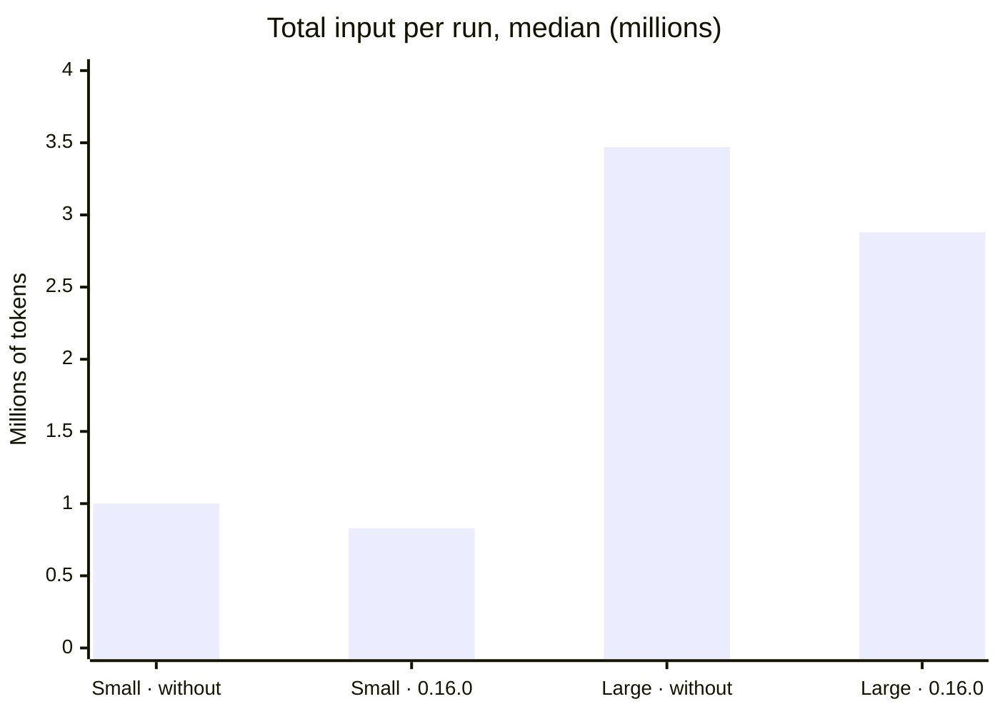
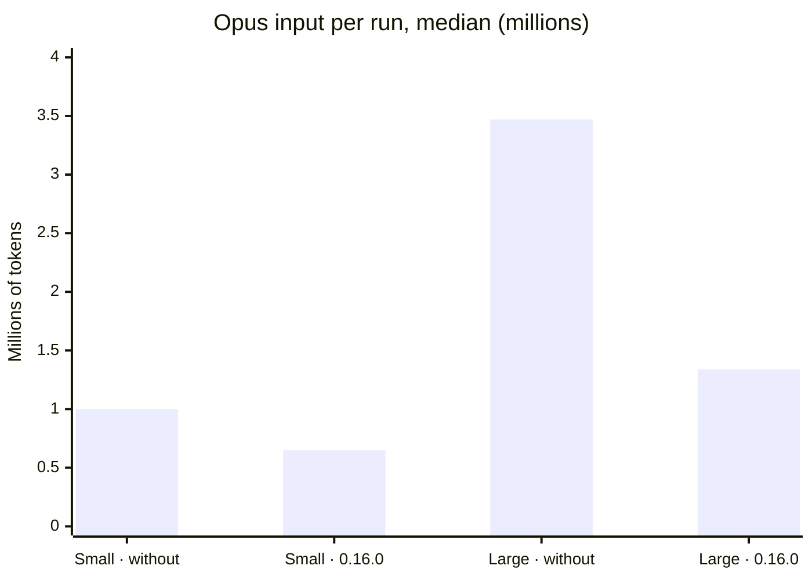

# Token benchmark: Claude Code with and without Flowestra

> **In short:** with Flowestra 0.16.0, delegation happens on its own: all 9 runs delegated and the lead made 0 file edits. On the two single-repository tasks, total input was **17% lower** than plain Claude Code, and Opus input fell more: **−35%** on the small task and **−61%** on the large one, because the work moved to Sonnet. On the **three-repository task** it went the other way: total input was **46% higher** and Opus input **36% higher**. The policy sent one repository's unit to an Opus worker in every run (shared contract or migration), and the lead's own input fell only 15%. The pass rate was the same everywhere (18/18, and 40/40 on the multi-repo task's hidden acceptance suite). The fixed overhead is about **8.9k tokens on every request**, mostly cached. The sample is small (3 runs per cell).

- **Measured:** 2026-11-16 · Flowestra 0.16.0 · Claude Code 2.1.325 · lead model Opus 5.5
- **Runs:** 18 fresh headless sessions (3 tasks × with/without × 3 repeats). All 18 finished with every test suite passing.
- **Without Flowestra:** the "without" runs are plain Claude Code with the mod disabled, so they do not depend on a Flowestra version.
- **Reproduce it:** everything used is in [`docs/benchmark/`](benchmark/).

---

## Results

0.16.0 sends every change to project files to a worker, usually one Sonnet unit (parallel units for bigger work). The orchestrator plans and reviews, and writes code itself only when the Sonnet switch is off. Each task was run 3 times with the mod on and 3 times with it off, with no forcing, from the same base commit `80f31ca`, with an Opus 5.5 lead.

"Input" counts every token the model read on every request: new input, cache writes and cache reads. That total doesn't change with cache warmth, so runs compare fairly whatever ran before them. "Output" is what the model wrote. Values are the median of 3, with the range in brackets.

| Task | Condition | Input | Output | Wall-clock | Tests |
|---|---|---:|---:|---:|---|
| Small (one journal fix) | Without Flowestra | **1.00M** (0.83–1.11M) | **12.4k** (11.4–13.5k) | 2 m 52 s (148–187 s) | 3/3 pass |
| Small (one journal fix) | Flowestra 0.16.0 | **0.83M** (0.70–0.93M) | **12.5k** (11.4–15.2k) | 2 m 25 s (123–174 s) | 3/3 pass |
| Large (three journal fixes) | Without Flowestra | **3.47M** (2.47–4.02M) | **37.2k** (35.8–39.4k) | 8 m 03 s (449–503 s) | 3/3 pass |
| Large (three journal fixes) | Flowestra 0.16.0 | **2.88M** (2.62–2.98M) | **44.0k** (39.5–53.0k) | 8 m 59 s (508–604 s) | 3/3 pass |

In all 6 Flowestra runs the work was delegated, and the lead made 0 file edits.

| 0.16.0 vs without (medians) | Small task | Large task |
|---|---:|---:|
| Total input | **−17%** | **−17%** |
| Opus input | **−35%** | **−61%** |
| Opus output | **−41%** | **−55%** |
| Total output | **+1%** | **+18%** |
| Wall-clock | **−16%** | **+12%** |

### The Opus and Sonnet split (0.16.0)

| Task | Opus input (lead, plus any Opus worker) | Sonnet input | Opus input, off | Lead requests (off) |
|---|---:|---:|---:|---:|
| Small | 0.65M (0.54–0.73M) | 0.15M (0.09–0.28M) | 1.00M (0.83–1.11M) | 11–15 (18–20) |
| Large | 1.34M (1.04–2.43M) | 1.58M (0.46–1.65M) | 3.47M (2.47–4.02M) | 15–20 (33–45) |

On the small task, all 3 runs delegated to one Sonnet worker and the lead made 0 file edits. On the large task, the lead alone read 1.12M (1.04–1.34M) of Opus input, and Opus output was 16.6k (14.5–37.4k) against 37.2k with the mod off. The Opus input range on the large task includes the run described below where one unit was escalated to an Opus worker.





Why it went down: the lead's context stays small. It makes fewer requests (11–20, against 18–45 with the mod off) because the edit, test and fix loop runs in the worker. Every lead request carries the full prompt of about 33k tokens (24k without the mod) plus a growing history, whereas the worker starts from a smaller prompt.

### Every run

| Run | Total input | Total output | Lead (Opus) in, out | Workers | Lead requests | Time | Tests after |
|---|---:|---:|---|---|---:|---:|---|
| without · small · 1 | 0.83M | 11.4k | all | none | 18 | 148 s | 1034 pass, 0 fail |
| without · small · 2 | 1.11M | 13.5k | all | none | 20 | 187 s | 1036 pass, 0 fail |
| without · small · 3 | 1.00M | 12.4k | all | none | 20 | 172 s | 1036 pass, 0 fail |
| without · large · 1 | 4.02M | 35.8k | all | none | 45 | 483 s | 1045 pass, 0 fail |
| without · large · 2 | 2.47M | 37.2k | all | none | 33 | 449 s | 1046 pass, 0 fail |
| without · large · 3 | 3.47M | 39.4k | all | none | 41 | 503 s | 1049 pass, 0 fail |
| 0.16.0 · small · 1 | 0.70M | 11.4k | 0.54M, 6.1k | Sonnet 0.15M, 5.3k | 11 | 123 s | 1032 pass, 0 fail |
| 0.16.0 · small · 2 | 0.83M | 12.5k | 0.73M, 7.3k | Sonnet 0.09M, 5.2k | 15 | 145 s | 1032 pass, 0 fail |
| 0.16.0 · small · 3 | 0.93M | 15.2k | 0.65M, 7.5k | Sonnet 0.28M, 7.7k | 13 | 174 s | 1037 pass, 0 fail |
| 0.16.0 · large · 1 | 2.62M | 44.0k | 1.04M, 16.6k | Sonnet 1.58M, 27.4k | 15 | 539 s | 1045 pass, 0 fail |
| 0.16.0 · large · 2 | 2.88M | 53.0k | 1.12M, 17.8k | Sonnet 0.46M, 15.6k, then Opus 1.31M, 19.7k | 17 | 604 s | 1044 pass, 0 fail |
| 0.16.0 · large · 3 | 2.98M | 39.5k | 1.34M, 14.5k | Sonnet 1.65M, 25.0k | 20 | 508 s | 1044 pass, 0 fail |

"all" means the single session did everything, so there is no separate worker. In 0.16.0 · large · 2 the Sonnet draft was incomplete. The lead escalated the unit to an Opus worker under the policy's escalation rule (§8) and then checked it itself.

The suite had 1029 tests before each run, so every run added tests. In all 12 runs the per-request token counts in the transcripts matched the engine's own usage ledger.

### Where the fixed cost comes from

| | Without Flowestra | Flowestra 0.16.0 | Difference |
|---|---:|---:|---:|
| First request, small task | ≈ 24.0k tokens | ≈ 32.9k tokens | **+8.9k** |
| First request, large task | ≈ 24.5k tokens | ≈ 33.3k tokens | **+8.9k** |

The difference is Flowestra's own text: the routing policy, the orchestrator workflow, the board instructions and the `AgentBoard` tool definition. It is sent with every lead request and almost all of it is read from cache after the first. In these runs the lead made 2–6 `AgentBoard` calls and wrote a `.flowestra/decisions.md` entry in 6 of 6 runs.

---

## Multi-repository task (three repositories, one shared contract)

The task: change three small Python repositories (`contract/`, `service/`, `client/`, about 1,600 lines together) to version 2 of their shared API contract. That means cursor pagination, one error envelope with typed client exceptions, idempotent order creation with client retries, and a field rename, with new tests and a changelog in each repository. The session starts in the parent folder of the three repositories. After each session, a **hidden acceptance suite** of 40 black-box tests, which the sessions never see, checks the result across all three. On the starting code it passes 1 of 40.

It was planned as an extra-large task, but a pilot run with the mod off finished in 7.5 minutes with 1.81M input. That makes it a medium-size multi-repository task, about the size of the large task above. Hours-long work is still unmeasured.

| Condition | Input | Output | Wall-clock | Tests |
|---|---:|---:|---:|---|
| Without Flowestra | **1.81M** (1.19–3.02M) | **56.0k** (52.7–68.0k) | 7 m 29 s (416–565 s) | 3/3 all suites pass, acceptance 40/40 |
| Flowestra 0.16.0 | **2.65M** (1.93–2.74M) | **77.6k** (64.0–80.9k) | 8 m 32 s (319–598 s) | 3/3 all suites pass, acceptance 40/40 |

| 0.16.0 vs without (medians) | Multi-repo task |
|---|---:|
| Total input | **+46%** |
| Opus input | **+36%** (2.46M against 1.81M) |
| Opus output | **+7%** (59.7k against 56.0k) |
| Lead input (Opus) | **−15%** (1.53M against 1.81M) |
| Lead output | **−56%** (24.7k against 56.0k) |
| Total output | **+39%** |
| Wall-clock | **+14%** |

In all 3 Flowestra runs, the lead split the work into three parallel units, one per repository, and made 0 project edits. It wrote only its `.flowestra/decisions.md` entry. In each run the policy sent one unit to an Opus worker:

| Run | Opus worker | Reason in the audit line |
|---|---|---|
| 0.16.0 · multi-repo · 1 | `contract/` (0.15M in) | Shared contract between repositories (§2) |
| 0.16.0 · multi-repo · 2 | `service/` (0.93M in) | Migration: a new SQLite table for idempotency keys (§2) |
| 0.16.0 · multi-repo · 3 | `service/` (0.90M in) | Migration: a new SQLite table for idempotency keys (§2) |

Why it went up here: the lead still read enough of all three repositories to write the spec, so its input fell only 15%. On top of that came three cold workers. When the Opus trigger landed on the service unit, that Opus worker alone read about 0.9M. A plain session did the same work in 16–33 requests with no handoffs. The policy's triggers fired as written (a shared contract, and a schema change on a database that keeps its data), so this is the cost of that rule on this kind of change, not a routing error.

### Every run

| Run | Total input | Total output | Lead (Opus) in, out | Workers | Lead requests | Time | Acceptance |
|---|---:|---:|---|---|---:|---:|---|
| without · multi-repo · 1 | 1.81M | 56.0k | all | none | 23 | 449 s | 40/40 |
| without · multi-repo · 2 | 1.19M | 52.7k | all | none | 16 | 416 s | 40/40 |
| without · multi-repo · 3 | 3.02M | 68.0k | all | none | 33 | 565 s | 40/40 |
| 0.16.0 · multi-repo · 1 | 1.93M | 64.0k | 1.43M, 23.0k | Sonnet 0.14M + 0.22M, Opus 0.15M | 17 | 319 s | 40/40 |
| 0.16.0 · multi-repo · 2 | 2.65M | 77.6k | 1.53M, 24.7k | Sonnet 0.06M + 0.12M, Opus 0.93M | 18 | 512 s | 40/40 |
| 0.16.0 · multi-repo · 3 | 2.74M | 80.9k | 1.56M, 24.7k | Sonnet 0.18M + 0.10M, Opus 0.90M | 19 | 598 s | 40/40 |

Every repository's own suite passed in all 6 runs, with 25–71 tests per repository afterwards against 16, 27 and 22 before. The first request was about 24.9k tokens without the mod and 33.7k with it, the same **+8.9k** as on the single-repository tasks. In all 6 runs the transcript totals matched the engine's usage ledger. "without · multi-repo · 1" was the pilot and ran alone. The other five ran in a batch of three, then a batch of two, with and without the mod mixed.

---

## How to read this honestly

- **Three runs per cell is a small sample.** On the small task the 0.16.0 range (0.70–0.93M) overlaps the mod-off range (0.83–1.11M), so the −17% in total input is not separable from run-to-run spread there. The Opus-token ranges do not overlap: 0.54–0.73M against 0.83–1.11M on the small task, and 1.04–2.43M against 2.47–4.02M on the large one. Even so, three runs is not enough for precise percentages.
- **Output and time went up on the large task.** Total output rose 18% (44.0k against 37.2k) and wall-clock rose 12% (8 m 59 s against 8 m 03 s), because the work is written by a worker and then reviewed by the lead.
- **Tokens are not weighted by model.** The totals add Opus and Sonnet tokens as if they were equal. Sonnet is the smaller model, so the Opus figures are shown separately. One large run escalated a unit to an Opus worker, which is counted in the Opus input range.
- **The multi-repo result is not separable from spread either.** Its total-input ranges overlap (1.93–2.74M with the mod against 1.19–3.02M without), and so do the Opus ranges (1.57–2.46M against 1.19–3.02M). The direction is consistent with how it was routed, but the size of the difference is not precise.
- **Large is relative.** The longest task took about 10 minutes. Hours-long work was not measured here. The multi-repo task was planned as extra-large but turned out medium-size (see above).
- **Two kinds of work.** The single-repository tasks were TypeScript changes in Flowestra's own repository. The multi-repo task was a Python contract change across three small, synthetic repositories built for the benchmark.
- **Headless runs skip the approval gate.** The prompt said the design was pre-approved, on both sides. In an interactive session the `full` workflow stops for your approval, which costs a turn of your time and few tokens.

---

## Benefits

| Benefit | What it gives you | What it costs |
|---|---|---|
| **Routing by rule** | Design and risky work goes to Opus, specified work with a test goes to Sonnet, read-only lookups go to Haiku, and every delegation records why it went where it did | Each worker starts cold and rereads what it needs |
| **A smaller lead context** | Workers run the edit, test and fix loop in their own context; the lead makes fewer requests (11–20 against 18–45 with the mod off) and keeps about 250-word returns, not file dumps. Measured: Opus input −35% on the small task and −61% on the large one | Total output and wall-clock rose on the large task (+18% and +12%) |
| **Parallel waves** | Independent units run at the same time; dependent ones wait | More tokens in total; less wall-clock time only when the units are really independent |
| **An approval gate** (`full`) | Nothing is built until you approve a written design | One round trip with you |
| **A durable record** | `.flowestra/decisions.md` holds the approved designs; the journal holds every brief, result and verdict | Disk space, and care with what the journal stores (see the README) |
| **Visibility** | A live board shows each worker's model, tool and real token counts, and a Tokens tab splits the lead from the workers | About 8.9k tokens of instructions on every request (mostly cached) |
| **Enforcement** | A gate refuses unplanned or off-policy spawns and forks, and records the agents it can't check | Built-in agent types are unavailable while the mod is loaded |

## Limitations

- **Each worker starts cold.** A worker rereads the files it needs, and a unit that fails at one tier is rerun at another.
- **Escalations add an Opus worker.** In one of the three large runs the Sonnet draft was incomplete and the unit was rerun on Opus, which added 1.31M Opus input.
- **Opus triggers can make cross-repo work dearer.** On the multi-repo task, every run sent one repository's unit to an Opus worker (shared contract, or a migration), and total input rose 46% against a plain session.
- **Output was larger on the large task.** Total output rose 18% and wall-clock 12% against the mod off.
- **The fixed prompt cost applies to every request,** whether or not you use the board.
- **There is no live counterfactual.** The Tokens tab shows what was spent, not what the same work would have cost without the mod.

## When a tool like this is still worth it

Token efficiency isn't the only thing that matters. These are the situations where an orchestrator earns its overhead:

1. **Long, multi-part projects.** In a session that runs for hours, the lead's context is reread on every turn and keeps growing. Moving the heavy reading into workers that end, and keeping only short returns, keeps the lead's context small.
2. **Work across several repositories, for the structure rather than the tokens.** One task per repository, each with its own phase and units, and one call to switch between them. On the medium-size multi-repo task measured here, this cost more tokens than a plain session (+46% input), so take it for the parallel units, the audit trail and the Opus review of the shared contract, not for savings.
3. **Teams and regulated environments that need an audit trail.** "Which model changed this, from what brief, and who accepted it?" is answered from the journal and `decisions.md`, not from memory or scrollback.
4. **Work where a wrong change is costly.** Migrations, security, auth and data deletion go to Opus by rule, and the approval gate keeps anything from being built before a design is agreed.
5. **Bulk mechanical work.** Searches, inventories, extraction and fix-until-green loops can go to Haiku or Sonnet in parallel instead of taking many turns of the top model.
6. **Learning how agents actually spend tokens.** The board and the Tokens tab show where the tokens went, per model and per worker, so you can see the split and check whether the trade pays on your own work.
7. **Keeping the top model for decisions.** The lead frames, routes and reviews; the workers do the reading and the routine edits.

**Rule of thumb:** delegation happens on its own. On single-repository work it cut total input by about 17% and Opus input by 35–61% at the same pass rate, with more output and time on the larger task. On the cross-repository change, where the policy's Opus triggers fired, it cost 46% more input. Plain Claude Code is still the simplest choice for a quick fix. Reach for Flowestra when you want the Opus share down, or when the work is long, wide, parallel or has to be auditable, and check the Tokens tab to confirm the trade on your own work.

---

## Method

| Control | How |
|---|---|
| Same code | Each run started from a fresh clone at commit `80f31ca` (the task's base code) in its own folder, so no memory or project state carried over |
| Same task text | [`common.txt`](benchmark/common.txt) plus [`small.txt`](benchmark/small.txt) or [`large.txt`](benchmark/large.txt), the same on both sides; both say the design is pre-approved |
| Mod on or off | `--settings '{"enabledPlugins":{"flowestra@…":false}}'` for off; on with `workflow: full` (the default). A probe confirmed the off sessions had no Flowestra tool or worker types |
| Mod version | With-mod runs loaded Flowestra 0.16.0 (commit `6713e52`) |
| Same model, same permissions | `--model opus --permission-mode bypassPermissions` on both sides |
| Cache warmth | Compared total input (new + cache write + cache read), which doesn't depend on caching; runs were launched in small parallel batches (two to four at a time) |
| Completion | Every session ended with no unfinished subagent, and `claude plugin test` passed afterwards in every clone |
| Counting | [`measure.py`](benchmark/measure.py) sums `message.usage` once per API response across the lead's and every subagent's transcript, and checks the total against the engine's own ledger (`cost-state.modelUsage`). They matched in all 18 runs |
| Multi-repo task | [`xl/run.sh`](benchmark/xl/run.sh) copies the three repositories from [`xl/fixture/`](benchmark/xl/fixture/) into one parent folder, makes each a git repository with one commit, and starts the session in the parent folder with the same flags. Afterwards it runs each repository's suite and the hidden [`xl/acceptance/`](benchmark/xl/acceptance/) suite. The prompt is [`xl/prompt.txt`](benchmark/xl/prompt.txt) and says the design is pre-approved |

The tasks were real, already-specified backlog items from Flowestra's own design notes: the small one is a single journal fix (verdict carry-over), and the large one is that fix plus a stale-writer guard and atomic temp-file writes. Results from the benchmark clones were not merged.

To reproduce:

```sh
export BENCH=/some/scratch/folder FLOWESTRA_REPO=https://github.com/Osanchez/Flowestra.git
for r in 1 2 3; do for c in off on; do for s in small large; do docs/benchmark/run.sh $s $c $r; done; done; done
for r in 1 2 3; do for c in off on; do docs/benchmark/xl/run.sh $c $r; done; done
python3 -I docs/benchmark/measure.py $BENCH
```

The multi-repo runs need only `python3` (3.9 or later, standard library). `xl/run.sh --dry off 0` runs the post-checks on the untouched fixture: every repository suite passes and the acceptance suite fails 39 of 40.

The "on" runs use whatever Flowestra version is installed, so install 0.16.0 or later. Runs with the mod on write to the real Flowestra journal under your Claude Code config folder. Delete those task folders afterwards, or use `/journal prune task <repo>/<task>`.
