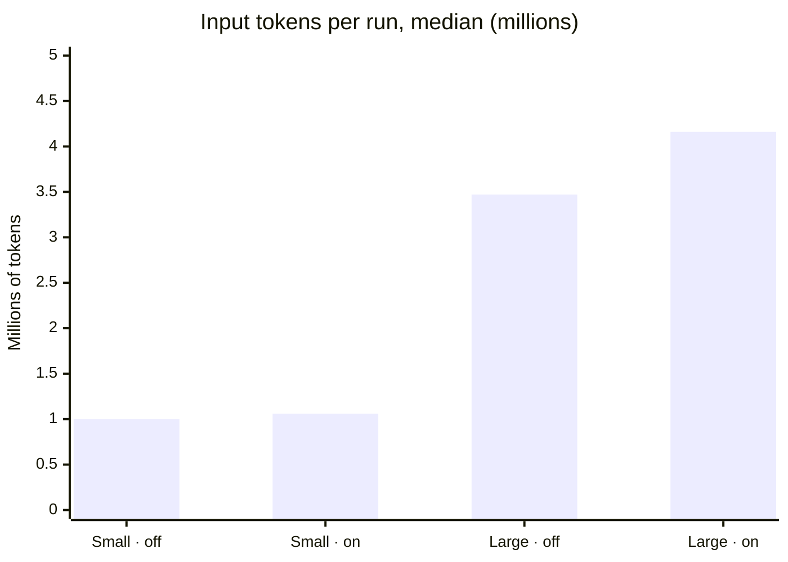

# Token benchmark: Claude Code with and without Flowestra

> **In short:** with Flowestra's default settings, a single session that does the work itself used about the same tokens as plain Claude Code. The medians were **+6%** on a small task and **+20%** on a larger one, and both differences are inside the run-to-run spread. The mod has a fixed cost of about **8.7k tokens on every request**, nearly all of it read back from cache. Delegating to workers is another matter. An earlier test that forced delegation on a small task used **3.2× the tokens**. Flowestra's value is control, visibility and an audit trail, and on large or long work it keeps the lead's context small. It does not make small tasks cheaper.

- **Measured:** 2026-11-16 · Flowestra 0.15.0 (commit `80f31ca`) · Claude Code 2.1.325 · lead model Opus 5.5
- **Runs:** 12 fresh headless sessions (2 tasks × 2 conditions × 3 repeats). All 12 finished with the test suite passing.
- **Reproduce it:** everything used is in [`docs/benchmark/`](benchmark/).

---

## Results

### Total tokens per run (median of 3, range in brackets)

"Input" counts every token the model read on every request: new input, cache writes and cache reads. That total doesn't change with cache warmth, so runs compare fairly whatever ran before them. "Output" is what the model wrote.

| Task | Condition | Input | Output | Wall-clock | Tests |
|---|---|---:|---:|---:|---|
| Small (one journal fix) | Flowestra **off** | **1.00M** (0.83–1.11M) | **12.4k** (11.4–13.5k) | 2 m 52 s | 3/3 pass |
| Small (one journal fix) | Flowestra **on** | **1.06M** (0.96–1.36M) | **11.7k** (11.3–12.4k) | 2 m 25 s | 3/3 pass |
| Large (three journal fixes) | Flowestra **off** | **3.47M** (2.47–4.02M) | **37.2k** (35.8–39.4k) | 8 m 03 s | 3/3 pass |
| Large (three journal fixes) | Flowestra **on** | **4.16M** (3.05–5.20M) | **37.0k** (31.5–49.4k) | 7 m 56 s | 3/3 pass |

| | Small task | Large task |
|---|---:|---:|
| Input, on vs off (medians) | **+6%** | **+20%** |
| Output, on vs off (medians) | −6% | −1% |
| Spread within one condition (input) | up to ±18% | up to ±29% |



### Every run

| Run | Input | of which cache reads | Output | Requests to the model | Time | Tests after |
|---|---:|---:|---:|---:|---:|---|
| small · off · 1 | 0.83M | 0.78M | 11.4k | 18 | 148 s | 1034 pass, 0 fail |
| small · off · 2 | 1.11M | 1.05M | 13.5k | 20 | 187 s | 1036 pass, 0 fail |
| small · off · 3 | 1.00M | 0.94M | 12.4k | 20 | 172 s | 1036 pass, 0 fail |
| small · on · 1 | 1.06M | 1.00M | 11.3k | 21 | 131 s | 1033 pass, 0 fail |
| small · on · 2 | 0.96M | 0.90M | 11.7k | 17 | 145 s | 1036 pass, 0 fail |
| small · on · 3 | 1.36M | 1.30M | 12.4k | 24 | 163 s | 1036 pass, 0 fail |
| large · off · 1 | 4.02M | 3.90M | 35.8k | 45 | 483 s | 1045 pass, 0 fail |
| large · off · 2 | 2.47M | 2.37M | 37.2k | 33 | 449 s | 1046 pass, 0 fail |
| large · off · 3 | 3.47M | 3.35M | 39.4k | 41 | 503 s | 1049 pass, 0 fail |
| large · on · 1 | 3.05M | 2.94M | 31.5k | 34 | 476 s | 1044 pass, 0 fail |
| large · on · 2 | 4.16M | 4.04M | 37.0k | 45 | 469 s | 1043 pass, 0 fail |
| large · on · 3 | 5.20M | 5.06M | 49.4k | 49 | 659 s | 1055 pass, 0 fail |

The suite had 1031 tests before each run, so every run added tests. In every run the per-request token counts in the transcripts matched the engine's own usage ledger exactly.

### Where the fixed cost comes from

| | Flowestra off | Flowestra on | Difference |
|---|---:|---:|---:|
| First request (system prompt, tools, task) | ≈ 24.0k tokens | ≈ 32.7k tokens | **+8.7k** |

That +8.7k is Flowestra's own text: the Model Routing Policy, the orchestrator workflow, the board instructions and the `AgentBoard` tool definition. It is sent with every request the lead makes, so a 20-request session reads about 170k more tokens and a 40-request one about 350k more, almost all as cache reads. That works out to roughly **+10–20% input** before any delegation, which matches the medians above. On top of it, the lead made 2–6 `AgentBoard` calls per run and, in 5 of 6 runs, wrote a `.flowestra/decisions.md` entry.

### What the lead chose to do

In all 6 Flowestra runs the lead **did not delegate**. It opened a task on the board, declared its own units, wrote the approved design to `decisions.md` and did the work itself. That is the 0.14.0 delegation threshold working as designed: "do it yourself when the work fits in about ten tool calls, or touches one or two files in one area". Both tasks, even the three-fix one, were judged small enough. **So this benchmark measures the cost of having the orchestrator available, not the cost of delegating.**

### What delegation costs (an earlier test)

An earlier experiment on Flowestra 0.12.0 forced delegation on a small task, before the threshold existed. It used a Fable 5.2 lead and **one run per condition**, so treat it as an anecdote:

| Condition (0.12.0, small task) | All tokens | Output | Wall-clock |
|---|---:|---:|---:|
| Flowestra off | 1.54M | 15.0k | 5 min |
| Flowestra on, did not delegate | 1.84M (+19%) | 17.5k | 9 min |
| Flowestra on, delegation forced | **4.88M (3.2×)** | **81.9k (5.5×)** | **24 min** |

In that run the lead's own tokens (1.48M) were about the same as the single session's (1.54M), so the workers came **on top**. The largest item was an Opus design draft at 1.78M, more than the whole session without the mod. That result is why 0.14.0 added the delegation threshold, the shorter worker returns and the rule that the lead drafts small designs itself.

---

## How to read this honestly

- **Three runs per cell is a small sample.** The spread inside one condition (2.47M to 4.02M for the same large task with the mod off) is wider than the gap between conditions. The +6% and +20% are best read as "about the same, plus a fixed per-request cost", not as precise percentages.
- **Tokens are not weighted by model.** Every run here used only Opus 5.5. When work is delegated, a Haiku or Sonnet token is not an Opus token, and this benchmark doesn't capture that.
- **Large is relative.** The "large" task took about 8 minutes. Work big enough for the lead to delegate on its own (hours long, many areas, several repositories) was not measured here, and that is where the orchestrator's design is meant to pay off.
- **One repository, one kind of work.** Both tasks were TypeScript changes with a test suite in Flowestra's own repository.
- **Headless runs skip the approval gate.** The prompt said the design was pre-approved, on both sides. In an interactive session the `full` workflow stops for your approval, which costs a turn of your time and few tokens.

---

## Benefits

| Benefit | What it gives you | What it costs |
|---|---|---|
| **Routing by rule** | Design and risky work goes to Opus, specified work with a test goes to Sonnet, read-only lookups go to Haiku, and every delegation records why it went where it did | Each worker starts cold and rereads what it needs |
| **A smaller lead context on long work** | Workers read the bulk of the code in their own context; the lead keeps about 250-word returns, not file dumps | Nothing on short tasks, where the threshold keeps the work in-house |
| **Parallel waves** | Independent units run at the same time; dependent ones wait | More tokens in total; less wall-clock time only when the units are really independent |
| **An approval gate** (`full`) | Nothing is built until you approve a written design | One round trip with you |
| **A durable record** | `.flowestra/decisions.md` holds the approved designs; the journal holds every brief, result and verdict | Disk space, and care with what the journal stores (see the README) |
| **Visibility** | A live board shows each worker's model, tool and real token counts, and a Tokens tab splits the lead from the workers | About 8.7k tokens of instructions on every request (mostly cached) |
| **Enforcement** | A gate refuses unplanned or off-policy spawns and forks, and records the agents it can't check | Built-in agent types are unavailable while the mod is loaded |

## Limitations

- **It does not save tokens on small or medium tasks.** At best it costs about the same (this benchmark). If you force delegation it costs several times more (the 0.12.0 test).
- **Delegation adds tokens; it doesn't replace them.** Workers spend their own tokens, and the lead still briefs and reviews them.
- **An Opus design draft is expensive.** One cost more than an entire plain session. The workflow now drafts small designs in the lead.
- **Delegating is slower on small work.** In the 0.12.0 test it took 24 minutes against 5.
- **The fixed prompt cost applies to every request,** whether or not you use the board.
- **There is no live counterfactual.** The Tokens tab shows what was spent, not what the same work would have cost without the mod.

## When a tool like this is still worth it

Token efficiency isn't the only thing that matters. These are the situations where an orchestrator earns its overhead:

1. **Long, multi-part projects.** In a session that runs for hours, the lead's context is reread on every turn. The session that built Flowestra 0.9 to 0.11 reread 277M cached tokens in its lead alone. Moving the heavy reading into workers that end, and keeping only short returns, stops that context from growing without bound.
2. **Work across several repositories.** One task per repository, each with its own phase and units, and one call to switch between them. The lead doesn't need to keep every project's history in its context.
3. **Teams and regulated environments that need an audit trail.** "Which model changed this, from what brief, and who accepted it?" is answered from the journal and `decisions.md`, not from memory or scrollback.
4. **Work where a wrong change is costly.** Migrations, security, auth and data deletion go to Opus by rule, and the approval gate keeps anything from being built before a design is agreed.
5. **Bulk mechanical work.** Searches, inventories, extraction and fix-until-green loops can go to Haiku or Sonnet in parallel instead of taking many turns of the top model.
6. **Learning how agents actually spend tokens.** The board and the Tokens tab show where the tokens went, per model and per worker. That visibility is how the 0.14.0 savings were found.
7. **Keeping the top model for decisions.** The lead frames, routes and reviews; the workers do the reading and the routine edits.

**Rule of thumb:** for a quick fix, plain Claude Code (or Flowestra, which will do it in-house anyway) is the efficient choice. Reach for delegation when the work is long, wide, parallel or has to be auditable, and watch the Tokens tab to check the trade is paying off.

---

## Method

| Control | How |
|---|---|
| Same code | Each run started from a fresh clone at commit `80f31ca` in its own folder, so no memory or project state carried over |
| Same task text | [`common.txt`](benchmark/common.txt) plus [`small.txt`](benchmark/small.txt) or [`large.txt`](benchmark/large.txt), the same on both sides; both say the design is pre-approved |
| Mod on or off | `--settings '{"enabledPlugins":{"flowestra@…":false}}'` for off; on with `workflow: full` (the default). A probe confirmed the off sessions had no Flowestra tool or worker types |
| Same model, same permissions | `--model opus --permission-mode bypassPermissions` on both sides |
| Cache warmth | Compared total input (new + cache write + cache read), which doesn't depend on caching; runs were launched in rounds of four, in alternating order |
| Completion | Every session ended with no unfinished subagent, and `claude plugin test` passed afterwards in every clone |
| Counting | [`measure.py`](benchmark/measure.py) sums `message.usage` once per API response across the lead's and every subagent's transcript, and checks the total against the engine's own ledger (`cost-state.modelUsage`). They matched in all 12 runs |

The tasks were real, already-specified backlog items from Flowestra's own design notes: the small one is a single journal fix (verdict carry-over), and the large one is that fix plus a stale-writer guard and atomic temp-file writes. Results from the benchmark clones were not merged.

To reproduce:

```sh
export BENCH=/some/scratch/folder FLOWESTRA_REPO=https://github.com/Osanchez/Flowestra.git
for r in 1 2 3; do for c in off on; do for s in small large; do docs/benchmark/run.sh $s $c $r; done; done; done
python3 -I docs/benchmark/measure.py $BENCH
```

Runs with the mod on write to the real Flowestra journal under your Claude Code config folder. Delete those task folders afterwards, or use `/journal prune task <repo>/<task>`.
