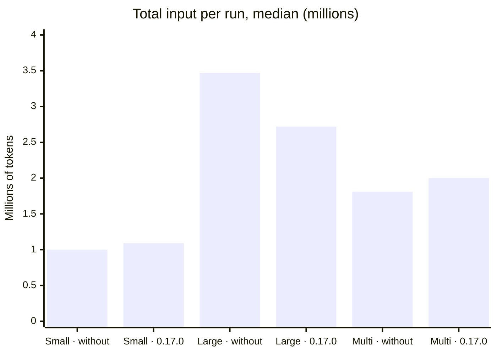
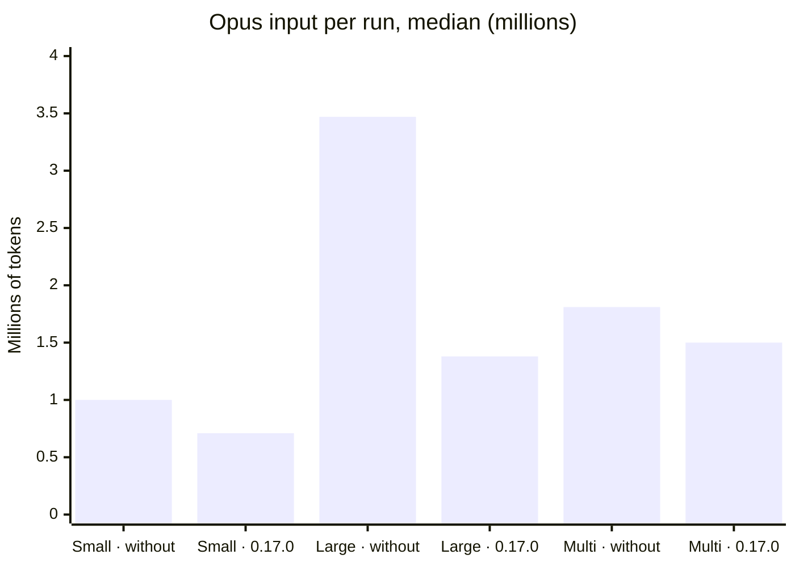

# Token benchmark: Claude Code with and without Flowestra

> **In short:** with Flowestra 0.17.0, delegation happens on its own: in all 9 runs Sonnet workers wrote every change, no Opus worker ran, and the lead edited no project file. **Opus input fell on every task:** −29% on the small task, −60% on the large one and −17% on the three-repository one. **Total input** was 22% lower on the large task, and about even on the small (+9%) and multi-repo (+10%) tasks, where both differences are within run-to-run spread. Total output was higher on every task (+9% to +36%). Wall-clock was 15–16% longer on the single-repository tasks and **29% shorter** on the multi-repo task, where three units ran in parallel. Every run passed, including 40/40 on the multi-repo task's hidden acceptance suite. The fixed overhead is about **9k tokens on every request**, mostly cached. The sample is small (3 runs per cell).

- **Measured:** 2026-11-16 · Flowestra 0.17.0 · Claude Code 2.1.325 · lead model Opus 5.5
- **Runs:** 18 fresh headless sessions (3 tasks × with/without × 3 repeats). All 18 finished with every test suite passing.
- **Without Flowestra:** the "without" runs are plain Claude Code with the mod disabled, so they do not depend on a Flowestra version.
- **Reproduce it:** everything used is in [`docs/benchmark/`](benchmark/).

---

## Results

0.17.0 sends every change to project files to a Sonnet worker: one unit for a small task, parallel units for bigger work. Opus triggers such as a migration or a shared contract decide who designs and reviews a change, not who writes it. The orchestrator plans, routes and reviews. Each task was run 3 times with the mod on and 3 times with it off, with no forcing and an Opus 5.5 lead.

"Input" counts every token the model read on every request: new input, cache writes and cache reads. That total doesn't change with cache warmth, so runs compare fairly whatever ran before them. "Output" is what the model wrote. Values are the median of 3, with the range in brackets.

| Task | Condition | Input | Output | Wall-clock | Tests |
|---|---|---:|---:|---:|---|
| Small (one journal fix) | Without Flowestra | **1.00M** (0.83–1.11M) | **12.4k** (11.4–13.5k) | 2 m 52 s (148–187 s) | 3/3 pass |
| Small (one journal fix) | Flowestra 0.17.0 | **1.09M** (0.86–1.15M) | **16.9k** (15.0–18.3k) | 3 m 18 s (174–230 s) | 3/3 pass |
| Large (three journal fixes) | Without Flowestra | **3.47M** (2.47–4.02M) | **37.2k** (35.8–39.4k) | 8 m 03 s (449–503 s) | 3/3 pass |
| Large (three journal fixes) | Flowestra 0.17.0 | **2.72M** (2.65–3.46M) | **45.2k** (41.4–46.4k) | 9 m 19 s (510–571 s) | 3/3 pass |
| Multi-repo (three repositories) | Without Flowestra | **1.81M** (1.19–3.02M) | **56.0k** (52.7–68.0k) | 7 m 29 s (416–565 s) | 3/3 pass, acceptance 40/40 |
| Multi-repo (three repositories) | Flowestra 0.17.0 | **2.00M** (1.85–2.27M) | **61.2k** (60.8–65.3k) | 5 m 20 s (315–346 s) | 3/3 pass, acceptance 40/40 |

| 0.17.0 vs without (medians) | Small task | Large task | Multi-repo task |
|---|---:|---:|---:|
| Total input | **+9%** | **−22%** | **+10%** |
| Opus input | **−29%** | **−60%** | **−17%** |
| Opus output | **−40%** | **−52%** | **−58%** |
| Total output | **+36%** | **+22%** | **+9%** |
| Wall-clock | **+15%** | **+16%** | **−29%** |

### The Opus and Sonnet split

| Task | Opus input (the lead) | Sonnet input (workers) | Opus input, without | Lead requests (without) |
|---|---:|---:|---:|---:|
| Small | 0.71M (0.55–0.79M) | 0.36M (0.31–0.37M) | 1.00M (0.83–1.11M) | 12–15 (18–20) |
| Large | 1.38M (0.74–1.65M) | 1.81M (1.34–1.91M) | 3.47M (2.47–4.02M) | 13–22 (33–45) |
| Multi-repo | 1.50M (1.31–1.79M) | 0.50M (0.49–0.54M) | 1.81M (1.19–3.02M) | 16–23 (16–33) |

In every Flowestra run, the only Opus tokens were the lead's own. The single-repository tasks each went to one Sonnet worker. On the multi-repo task the lead split the work into three parallel Sonnet units, one per repository.





**Why Opus input fell:** the edit, test and fix loop runs in a Sonnet worker, so the lead makes fewer requests. Every lead request carries the full prompt of about 33k tokens (24k without the mod) plus a growing history.

**Why total input fell only on the large task:** delegation adds a spec, a brief, a worker that starts cold and rereads the code, and a review. That pays off only when it replaces a long loop in a plain session: 33–45 requests on the large task. On the small task the plain session needed 18–20 requests. On the multi-repo task it needed 16–33, because it rewrote whole files in a few large shell commands. In those two tasks the added cost about cancels the saving.

### Every run

| Run | Total input | Total output | Lead (Opus) in, out | Workers (Sonnet) in, out | Lead requests | Time | Tests after |
|---|---:|---:|---|---|---:|---:|---|
| without · small · 1 | 0.83M | 11.4k | all | none | 18 | 148 s | 1034 pass, 0 fail |
| without · small · 2 | 1.11M | 13.5k | all | none | 20 | 187 s | 1036 pass, 0 fail |
| without · small · 3 | 1.00M | 12.4k | all | none | 20 | 172 s | 1036 pass, 0 fail |
| without · large · 1 | 4.02M | 35.8k | all | none | 45 | 483 s | 1045 pass, 0 fail |
| without · large · 2 | 2.47M | 37.2k | all | none | 33 | 449 s | 1046 pass, 0 fail |
| without · large · 3 | 3.47M | 39.4k | all | none | 41 | 503 s | 1049 pass, 0 fail |
| without · multi-repo · 1 | 1.81M | 56.0k | all | none | 23 | 449 s | acceptance 40/40 |
| without · multi-repo · 2 | 1.19M | 52.7k | all | none | 16 | 416 s | acceptance 40/40 |
| without · multi-repo · 3 | 3.02M | 68.0k | all | none | 33 | 565 s | acceptance 40/40 |
| 0.17.0 · small · 1 | 1.09M | 18.3k | 0.71M, 7.5k | 0.37M, 10.8k | 14 | 230 s | 1034 pass, 0 fail |
| 0.17.0 · small · 2 | 1.15M | 16.9k | 0.79M, 8.3k | 0.36M, 8.6k | 15 | 198 s | 1035 pass, 0 fail |
| 0.17.0 · small · 3 | 0.86M | 15.0k | 0.55M, 7.1k | 0.31M, 7.9k | 12 | 174 s | 1033 pass, 0 fail |
| 0.17.0 · large · 1 | 2.72M | 45.2k | 1.38M, 21.0k | 1.34M, 24.2k | 19 | 559 s | 1046 pass, 0 fail |
| 0.17.0 · large · 2 | 3.46M | 46.4k | 1.65M, 17.9k | 1.81M, 28.5k | 22 | 571 s | 1046 pass, 0 fail |
| 0.17.0 · large · 3 | 2.65M | 41.4k | 0.74M, 12.7k | 1.91M, 28.8k | 13 | 510 s | 1044 pass, 0 fail |
| 0.17.0 · multi-repo · 1 | 1.85M | 65.3k | 1.31M, 23.6k | 0.04M + 0.15M + 0.34M; 41.7k | 16 | 346 s | acceptance 40/40 |
| 0.17.0 · multi-repo · 2 | 2.00M | 61.2k | 1.50M, 20.8k | 0.38M + 0.08M + 0.04M; 40.4k | 19 | 315 s | acceptance 40/40 |
| 0.17.0 · multi-repo · 3 | 2.27M | 60.8k | 1.79M, 23.5k | 0.30M + 0.14M + 0.05M; 37.3k | 23 | 320 s | acceptance 40/40 |

"all" means the single session did everything, so there is no separate worker. No unit was rejected or escalated, and the gate refused no spawn. The Flowestra suite had 1029 tests before each single-repository run, so every run added tests. In the multi-repo runs, every repository's own suite passed too, with 25–71 tests per repository afterwards against 16, 27 and 22 before. In all 18 runs the per-request token counts in the transcripts matched the engine's own usage ledger.

### Where the fixed cost comes from

| | Without Flowestra | Flowestra 0.17.0 | Difference |
|---|---:|---:|---:|
| First request, small task | ≈ 24.0k tokens | ≈ 33.0k tokens | **+9.0k** |
| First request, large task | ≈ 24.5k tokens | ≈ 33.5k tokens | **+9.0k** |
| First request, multi-repo task | ≈ 24.9k tokens | ≈ 33.8k tokens | **+8.9k** |

The difference is Flowestra's own text: the routing policy, the orchestrator workflow, the board instructions and the `AgentBoard` tool definition. It is sent with every lead request and almost all of it is read from cache after the first. In one Flowestra run per task the first request was about 2k tokens smaller.

The lead made 2 `AgentBoard` calls per single-repository run and 4–6 per multi-repo run, and wrote a `.flowestra/decisions.md` entry in 9 of 9 runs. The prompt tells it to send board updates together with its next action. Requests whose only call was `AgentBoard` were 1 per single-repository run (6–10% of the lead's input) and 2–3 per multi-repo run (10–16%).

---

## The multi-repository task

The task: change three small Python repositories (`contract/`, `service/`, `client/`, about 1,600 lines together) to version 2 of their shared API contract. That means cursor pagination, one error envelope with typed client exceptions, idempotent order creation with client retries, and a field rename, with new tests and a changelog in each repository. The session starts in the parent folder of the three repositories. After each session, a **hidden acceptance suite** of 40 black-box tests, which the sessions never see, checks the result across all three. On the starting code it passes 1 of 40.

It was planned as an extra-large task, but a pilot run with the mod off finished in 7.5 minutes with 1.81M input. That makes it a medium-size multi-repository task, about the size of the large task. Hours-long work is still unmeasured.

The change touches a shared contract and adds a database table, both of which are Opus triggers in the routing policy. In 0.17.0 those triggers decide who designs and reviews the change. In all 3 runs the lead wrote the spec itself and sent each repository's part to a Sonnet worker, in parallel. No Opus worker ran.

---

## How to read this honestly

- **Three runs per cell is a small sample.** The total-input ranges overlap on the small task (0.86–1.15M against 0.83–1.11M) and on the multi-repo task (1.85–2.27M against 1.19–3.02M), so "+9%" and "+10%" there mean "about even", not a measured increase. On the large task they barely touch (2.65–3.46M against 2.47–4.02M). The Opus-input ranges do not overlap on the small and large tasks (0.55–0.79M against 0.83–1.11M, and 0.74–1.65M against 2.47–4.02M). On the multi-repo task they do (1.31–1.79M against 1.19–3.02M).
- **Output and time went up on the single-repository tasks.** Total output rose 22–36% and wall-clock 15–16%, because a worker writes the work and the lead then reviews it. On the multi-repo task the parallel units made the run 29% shorter.
- **Tokens are not weighted by model.** The totals add Opus and Sonnet tokens as if they were equal. Sonnet is the smaller model, so the Opus figures are shown separately.
- **Large is relative.** The longest task took about 10 minutes. Hours-long work was not measured here.
- **Two kinds of work.** The single-repository tasks were TypeScript changes in Flowestra's own repository. The multi-repo task was a Python contract change across three small repositories built for the benchmark.
- **Headless runs skip the approval gate.** The prompt said the design was pre-approved, on both sides. In an interactive session the `full` workflow stops for your approval, which costs a turn of your time and few tokens.

---

## Benefits

| Benefit | What it gives you | What it costs |
|---|---|---|
| **Routing by rule** | Design and risky work gets Opus-level design and review, Sonnet writes, read-only lookups go to Haiku, and every delegation records why it went where it did | Each worker starts cold and rereads what it needs |
| **A smaller lead context** | Workers run the edit, test and fix loop in their own context; the lead makes fewer requests (12–23 against 16–45 with the mod off) and keeps about 250-word returns, not file dumps. Measured: Opus input −17% to −60% | More total output on every task (+9% to +36%) |
| **Parallel waves** | Independent units run at the same time; dependent ones wait. Measured on the multi-repo task: 29% less wall-clock | Each unit is another cold start |
| **An approval gate** (`full`) | Nothing is built until you approve a written design | One round trip with you |
| **A durable record** | `.flowestra/decisions.md` holds the approved designs; the journal holds every brief, result and verdict | Disk space, and care with what the journal stores (see the README) |
| **Visibility** | A live board shows each worker's model, tool and real token counts, and a Tokens tab splits the lead from the workers | About 9k tokens of instructions on every request (mostly cached) |
| **Enforcement** | A gate refuses unplanned or off-policy spawns and forks, and records the agents it can't check | Built-in agent types are unavailable while the mod is loaded |

## Limitations

- **Each worker starts cold.** A worker rereads the files it needs. On a short task this extra reading roughly cancels what the lead saves.
- **More output and slower on single-repository work.** Total output rose 22–36% and wall-clock 15–16% against the mod off.
- **The fixed prompt cost applies to every request,** whether or not you use the board.
- **There is no live counterfactual.** The Tokens tab shows what was spent, not what the same work would have cost without the mod.

## When a tool like this is still worth it

Token efficiency isn't the only thing that matters. These are the situations where an orchestrator earns its overhead:

1. **Long, multi-part projects.** In a session that runs for hours, the lead's context is reread on every turn and keeps growing. Moving the heavy reading into workers that end, and keeping only short returns, keeps the lead's context small.
2. **Work across several repositories.** One task per repository, and the work split into parallel units. On the multi-repo task measured here, total input was about even with a plain session, Opus input was 17% lower, and wall-clock was 29% shorter.
3. **Teams and regulated environments that need an audit trail.** "Which model changed this, from what brief, and who accepted it?" is answered from the journal and `decisions.md`, not from memory or scrollback.
4. **Work where a wrong change is costly.** Migrations, security, auth and data deletion get Opus-level design and review by rule, and the approval gate keeps anything from being built before a design is agreed.
5. **Bulk mechanical work.** Searches, inventories, extraction and fix-until-green loops can go to Haiku or Sonnet in parallel instead of taking many turns of the top model.
6. **Learning how agents actually spend tokens.** The board and the Tokens tab show where the tokens went, per model and per worker, so you can see the split and check whether the trade pays on your own work.
7. **Keeping the top model for decisions.** The lead frames, routes and reviews; the workers do the reading and the routine edits.

**Rule of thumb:** delegation happens on its own and moves the work from Opus to Sonnet: Opus input fell 17–60% at the same pass rate. Total input fell only when the plain session would have looped for a long time: −22% on the large task, about even on the small and multi-repo tasks. Output was higher in every case. Plain Claude Code is still the simplest choice for a quick fix. Reach for Flowestra when you want the Opus share down, or when the work is long, wide, parallel or has to be auditable, and check the Tokens tab to confirm the trade on your own work.

---

## Method

| Control | How |
|---|---|
| Same code | Each single-repository run started from a fresh clone at commit `80f31ca` (the task's base code) in its own folder, so no memory or project state carried over |
| Same task text | [`common.txt`](benchmark/common.txt) plus [`small.txt`](benchmark/small.txt) or [`large.txt`](benchmark/large.txt), and [`xl/prompt.txt`](benchmark/xl/prompt.txt) for the multi-repo task, the same on both sides; all say the design is pre-approved |
| Multi-repo task | [`xl/run.sh`](benchmark/xl/run.sh) copies the three repositories from [`xl/fixture/`](benchmark/xl/fixture/) into one parent folder, makes each a git repository with one commit, and starts the session in the parent folder with the same flags. Afterwards it runs each repository's suite and the hidden [`xl/acceptance/`](benchmark/xl/acceptance/) suite |
| Mod on or off | `--settings '{"enabledPlugins":{"flowestra@…":false}}'` for off; on with `workflow: full` (the default). A probe confirmed the off sessions had no Flowestra tool or worker types |
| Mod version | With-mod runs loaded Flowestra 0.17.0 (commit `6ddeb6f`) |
| Same model, same permissions | `--model opus --permission-mode bypassPermissions` on both sides |
| Cache warmth | Compared total input (new + cache write + cache read), which doesn't depend on caching; runs were launched in small parallel batches (two to four at a time), and the 0.17.0 runs in three batches of one run per task |
| Completion | Every session ended with no unfinished subagent, and every test suite passed afterwards |
| Counting | [`measure.py`](benchmark/measure.py) sums `message.usage` once per API response across the lead's and every subagent's transcript, and checks the total against the engine's own ledger (`cost-state.modelUsage`). They matched in all 18 runs |

The single-repository tasks were real, already-specified backlog items from Flowestra's own design notes: the small one is a single journal fix (verdict carry-over), and the large one is that fix plus a stale-writer guard and atomic temp-file writes. Results from the benchmark clones were not merged.

To reproduce:

```sh
export BENCH=/some/scratch/folder FLOWESTRA_REPO=https://github.com/Osanchez/Flowestra.git
for r in 1 2 3; do for c in off on; do for s in small large; do docs/benchmark/run.sh $s $c $r; done; done; done
for r in 1 2 3; do for c in off on; do docs/benchmark/xl/run.sh $c $r; done; done
python3 -I docs/benchmark/measure.py $BENCH
```

The multi-repo runs need only `python3` (3.9 or later, standard library). `xl/run.sh --dry off 0` runs the post-checks on the untouched fixture: every repository suite passes and the acceptance suite fails 39 of 40.

The "on" runs use whatever Flowestra version is installed, so install 0.17.0 or later. Runs with the mod on write to the real Flowestra journal under your Claude Code config folder. Delete those task folders afterwards, or use `/journal prune task <repo>/<task>`.
